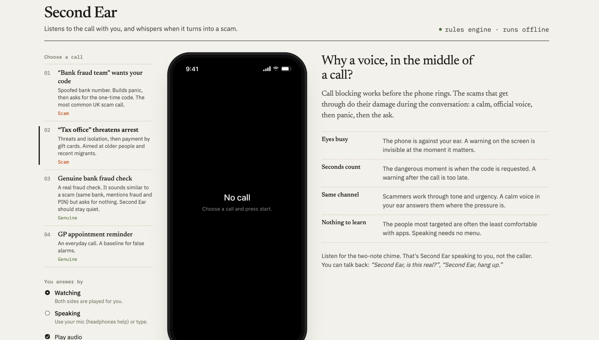
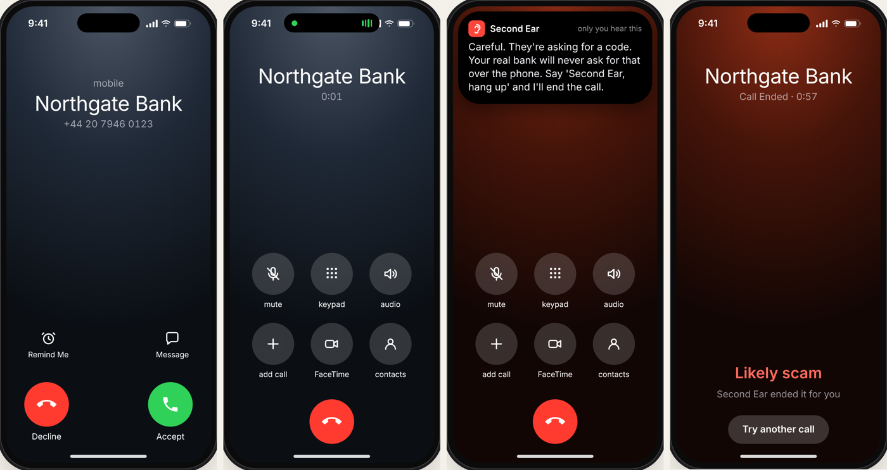

# Second Ear

**A live scam-call co-pilot that whispers warnings into your ear while the call is still happening.**

Hiya Voice AI Challenge 2026 · Tracks: **Security** + **Real-Time Assistance**

When a "bank fraud team" calls and asks for the code they've "just sent you", the person on the phone has the handset against their ear. A warning on the screen is invisible to them, and a report after the call is too late. Second Ear listens to the call, spots scam tactics as they happen, and says something quietly in the user's ear at the moment it matters:

> *(soft chime)* "Careful. They're asking for a code. Your real bank will never ask for that over the phone. Say 'Second Ear, hang up' and I'll end the call."

The user can answer it hands-free: *"Second Ear, is this real?"* / *"Second Ear, hang up."* / *"Second Ear, tell my daughter."*

---

## Run it in 2 minutes

**No API keys and no accounts needed.** Everything below runs locally.

### 1. Check you have the prerequisites

| You need | Check by running | If it's missing |
|---|---|---|
| **Node.js 20 or newer** | `node -v` (should print `v20` or higher) | Install the LTS version from [nodejs.org](https://nodejs.org) |
| **Git** | `git --version` | Install from [git-scm.com](https://git-scm.com), or download the ZIP from GitHub (green **Code** button → **Download ZIP**) |
| **Chrome or Edge** | – | Speech recognition (Speaking mode) only works in these. Everything else also works in Safari and Firefox. |

### 2. Download the code

```bash
git clone https://github.com/pakindipe/SecondEar.git
```

```bash
cd SecondEar
```

### 3. Install dependencies (about 30 seconds)

```bash
npm install
```

### 4. Start the app

```bash
npm run dev
```

Leave this terminal open. When it's ready you'll see two lines like:

```
[api] Second Ear API on http://localhost:8787 (risk engine: rules only)
[web]   ➜  Local:   http://localhost:5173/
```

### 5. Open it and take a call

1. Go to **http://localhost:5173** in Chrome.
2. Under **Choose a call**, pick **01 "Bank fraud team" wants your code**.
3. Leave **Watching** and **Play audio** selected, and turn your volume up.
4. Press **Start incoming call**, then press the green **Accept** button on the phone.
5. Listen for the two-note chime. That's Second Ear whispering. Its words appear in the phone's Dynamic Island, and the analysis and transcript fill in on the right.

Then try **03 Genuine bank fraud check**. It mentions fraud and PINs, but Second Ear should stay silent.

**To stop the app:** press `Ctrl + C` in the terminal.



### Troubleshooting

| Problem | Fix |
|---|---|
| `npm: command not found` | Node.js isn't installed. See step 1. |
| No sound | Check **Play audio** is ticked and your system volume is up. Voices come from your OS: macOS and Windows include them, but some Linux setups have none. In that case the call still runs silently at normal pace. |
| `EADDRINUSE` / address already in use | Another program is using port 8787. Often it's an earlier `npm run dev` still running in another terminal. Close it with `Ctrl + C` and try again. |
| Page is on a different port than 5173 | Something else was using 5173, so Vite picked the next free port. Use the URL printed in the terminal. |
| Speaking mode: "Microphone blocked" | Click the camera/mic icon in Chrome's address bar and allow the microphone, or just type your replies. |
| Speaking mode: the mic hears the caller | Use headphones. |

### Optional: add the LLM risk engine

The rules engine works on its own. To also run an LLM engine alongside it (it's aimed at scams that are reworded to avoid keywords):

1. Copy the example settings file. On Windows use `copy` instead of `cp`.
   ```bash
   cp .env.example .env
   ```
2. Open `.env` and paste your key after `ANTHROPIC_API_KEY=` (or `OPENAI_API_KEY=`). Get one from [console.anthropic.com](https://console.anthropic.com) or [platform.openai.com](https://platform.openai.com). A Claude Pro or ChatGPT Plus subscription doesn't include API access.
3. Stop the app (`Ctrl + C`) and run `npm run dev` again. The header now reads `rules + Claude` (or `rules + OpenAI`).

### Other commands

| Command | What it does |
|---|---|
| `npm run eval` | Scores 18 labelled call transcripts (11 scam, 7 genuine) and prints how many each engine catches. It includes the LLM automatically if a key is set. |
| `npm run build && npm start` | Production build, served as a single server at http://localhost:8787. |
| `npm run typecheck` | TypeScript check. |

---

## Using it

| Mode | What happens |
|---|---|
| **Watching** | Both sides of the call are played for you. Best first look; no mic needed. |
| **Speaking** | You play the person who answered. Speak your replies (or type them, or click the suggested line). **Use headphones** so the mic doesn't pick up the caller. |

Scenarios (all organisations are fictional):

1. **"Bank fraud team" wants your code.** Panic, then a one-time-code request, then a "safe account". Watch it cut in when the user starts reading the code out.
2. **"Tax office" threatens arrest.** Threats, secrecy, gift cards.
3. **Genuine bank fraud check.** Same bank, mentions fraud and PINs, but asks for nothing. Second Ear should stay quiet. *(This is the false-alarm test.)*
4. **GP appointment reminder.** Baseline normal call.

Untick **Play audio** to run silently at faster speed (useful for a quick look, or if the browser has no voices).



---

## How it works

```
                 ┌──────────── browser ─────────────────────────────────────────────┐
 scripted caller │ speechSynthesis ──► transcript ◄── SpeechRecognition (your mic)   │
                 │                         │                                         │
                 │                         ▼                                         │
                 │             rules engine (instant, offline)  ──┐                  │
                 │                         │                      ├─► merge (max) ─► whisper policy ─► chime + whisper TTS
                 │                         └─► POST /api/analyze ─┘                  │
                 └─────────────────────────────────│────────────────────────────────┘
                                                   ▼
                                    server: Claude / OpenAI (optional)
```

| File | Role |
|---|---|
| `src/shared/rules.ts` | Regex-based tactic detector + scoring. Every hit carries the exact phrase as evidence. Recognises *protective* phrases ("we will never ask for your PIN") so genuine callers aren't flagged. |
| `server/llm.ts` | LLM engine: structured output (forced tool call / JSON mode) with the same tactic taxonomy. Catches paraphrased scams the rules miss. |
| `src/lib/assist.ts` | Pure decision logic: merging engines, *when* to whisper and *what* to say, voice-command parsing, post-call summary. |
| `src/lib/callEngine.ts` | The call state machine: caller turn → assess → whisper → user turn → assess. Handles real-time cut-in. |
| `src/lib/speech.ts` | Web Speech API wrappers (TTS with fallback timers, continuous STT with silence detection) and Web Audio earcons. |
| `src/shared/scenarios.ts` | Scripted calls. |
| `eval/` | Labelled fixtures and the evaluation script. |

Design decisions and trade-offs are in **[DECISIONS.md](DECISIONS.md)**. The one-page write-up is **[WRITEUP.md](WRITEUP.md)**. AI tool usage is in **[ai.md](ai.md)**.

---

## Known limitations

- **It's a simulated call.** The caller is scripted TTS, not a real phone line. A real product would sit in the phone's call audio path (see WRITEUP "What's next").
- **Speech recognition needs Chrome/Edge.** In Chrome, the Web Speech API sends audio to Google's servers. In Firefox/Safari you can type replies instead.
- **Voice commands are heard by the caller too** in this prototype. A real product would use a side-button press-to-talk or on-device keyword spotting, and mute the uplink while you speak to Second Ear.
- **The rules engine misses paraphrased scams.** That's measured in `npm run eval` and is the reason for the LLM engine.
